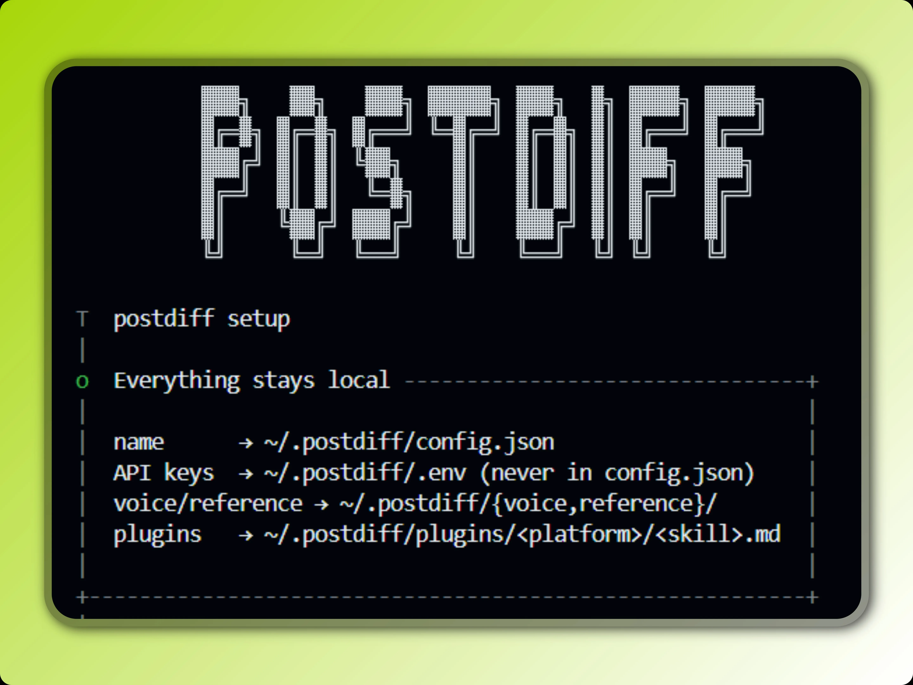
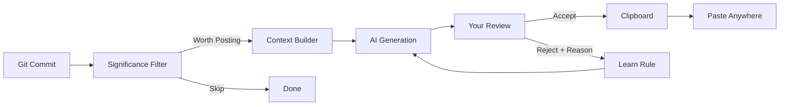

<div align="center">


# Postdiff

**Turn commits into posts that sound like you wrote them.**

[](https://www.npmjs.com/package/postdiff)
[](LICENSE)
[](https://www.typescriptlang.org/)
[](CONTRIBUTING.md)

<p align="center">
  
</p>

[Quick Start](#-quick-start) • [Features](#-features) • [How It Works](#-how-it-works) • [Commands](#-commands) • [Documentation](PRD.md)

</div>

---

## 🎯 The Problem

You ship code. You know you should post about it. You don't — not because you have nothing to say, but because saying it well costs an hour you'd rather spend building.

## 💡 The Solution

Postdiff reads your commits and writes the post for you: a short post for X, a longer one for LinkedIn, a full blog draft. **In your voice**, about the parts of the change that actually matter, and **never posted without you approving it first**.

---

## ✨ Features

<table>
<tr>
<td width="50%">

### 🎭 Your Voice, Preserved
Most AI post generators write like a press release. Postdiff learns who you are, how you talk, and what you're building — from a voice profile you write and posts you've made that sound like you.

</td>
<td width="50%">

### 🎯 Smart Filtering
Not every commit deserves a post. A significance filter decides whether a change is worth talking about — refactors, chores, and "update deps" commits stay quiet.

</td>
</tr>
<tr>
<td width="50%">

### ⚡ Instant Drafts
The hardest part of building in public isn't the posting, it's writing the thing. Postdiff hands you a finished draft in seconds. Your job shrinks to reading it and hitting accept.

</td>
<td width="50%">

### 🔒 Private by Default
Keys live in `~/.postdiff/.env`, never in config files. Your voice profile, references, learned rules, and drafts stay local. No platform logins, no OAuth, no data leaks.

</td>
</tr>
</table>

### 📊 What It Promises

<div align="center">

| 📝 | 🎯 | 🔐 | 🚫 |
|:---:|:---:|:---:|:---:|
| **3 Post Types** | **1 Command** | **0 Surprises** | **0 Logins** |
| Short posts, long posts, full blogs | No tabs, no dashboards | Nothing posts itself | Copy, paste, done |

</div>

---

## 🚀 Quick Start

```bash
# Install globally
npm i -g postdiff

# Generate your first post
postdiff generate
```

The first run walks you through:
- Your name
- A [TypeSafe key](https://console.typesafe.ai/keys) (for significance filtering)
- Your preferred AI provider and model
- API key validation (before anything is saved)

Change any setting later with `postdiff setup`.

### 🎨 Make It Better

Two things sharpen the drafts (both optional, both worth it):

```bash
# Create a voice profile
postdiff voice

# Add reference posts that sound like you
postdiff reference
```

### 🔄 The Loop

```
postdiff generate → postdiff review → postdiff publish
```

That's it. That's the whole workflow.

---

## 🛠️ How It Works



1. **Extract**: `postdiff generate` reads the latest commit — message, parent commit, shaped diff, and changed file contents
2. **Filter**: Significance filter decides if the change is worth talking about
3. **Generate**: AI writes a draft in your voice, for your chosen format
4. **Review**: You read, edit if needed, accept or reject
5. **Publish**: Copy to clipboard → paste wherever you post

---

## 📚 Commands

<table>
<thead>
<tr>
<th width="35%">Command</th>
<th>What it does</th>
</tr>
</thead>
<tbody>
<tr>
<td><code>postdiff setup</code></td>
<td>Configure name, TypeSafe key, provider, model, API key — validated live</td>
</tr>
<tr>
<td><code>postdiff generate [sha]</code></td>
<td>Draft from the latest commit (or specific SHA). Use <code>--force</code> to skip significance filter, <code>--web</code> for web search</td>
</tr>
<tr>
<td><code>postdiff review [sha]</code></td>
<td>Accept or reject drafts. Rejections with reasons become learned rules</td>
</tr>
<tr>
<td><code>postdiff publish [sha]</code></td>
<td>Copy accepted draft to clipboard. Use <code>--blog</code>, <code>--x</code>, or <code>--linkedin</code> for format hints</td>
</tr>
<tr>
<td><code>postdiff voice</code></td>
<td>Create or edit your voice profile</td>
</tr>
<tr>
<td><code>postdiff reference</code></td>
<td>Collect posts that sound like you for better voice matching</td>
</tr>
<tr>
<td><code>postdiff preferences</code></td>
<td>View and edit learned rules from rejected drafts</td>
</tr>
<tr>
<td><code>postdiff context [sha]</code></td>
<td>See exactly what the engine sees for a commit</td>
</tr>
</tbody>
</table>

---

## 🎯 Key Principles

### ✅ You Approve Everything

**Nothing posts itself.** There are no platform logins, no OAuth, no compose tabs. `postdiff publish` copies the accepted draft to your clipboard; you paste it wherever you like. It behaves identically on every platform because it never touches them.

### 🔍 One Commit, One Draft

The engine sees:
- Commit message
- Parent commit
- Shaped diff
- Changed file contents

Nothing else. Curious what it sees? Run `postdiff context`.

### 🧠 It Learns From Rejections

Reject a draft with a reason and that reason becomes a rule. See and edit learned rules with `postdiff preferences`.

### 🚀 Override When Needed

`postdiff generate --force` writes a post for any commit, significance filter be damned.

---

## 🤖 AI Providers

Choose from **10 providers** through one registry:

<div align="center">

| Provider | Default | Models |
|:--------:|:-------:|:------:|
| **Groq** ⚡ | ✅ | Llama 3.1, Mixtral, Gemma 2 |
| OpenAI | | GPT-4, GPT-3.5 |
| Anthropic | | Claude 3.5, Claude 3 |
| Google Gemini | | Gemini 1.5 Pro/Flash |
| xAI | | Grok |
| Mistral | | Mistral Large/Medium/Small |
| DeepSeek | | DeepSeek Coder/Chat |
| OpenRouter | | 100+ models |
| Together.ai | | 50+ open models |
| Fireworks | | Fast inference |

</div>

Pick your provider and model with `postdiff setup`. Web search support varies by provider (opt-in with `--web` flag).

---

## 📦 Project Structure

```
postdiff/
├── packages/
│   └── core/              # Engine logic (UI-agnostic)
│       ├── significance/  # Jev-based filtering
│       ├── generation/    # AI provider registry
│       └── context/       # Commit context building
├── apps/
│   ├── terminal/          # CLI + TUI interface
│   └── web/              # Web interface (future)
└── docs/                  # Documentation
```

---

## 🔐 Environment Variables

Loaded from `cwd/.env` if not already set:

```bash
# Required for significance filtering
TYPESAFE_API_KEY=your_typesafe_key

# Provider keys (set one based on your chosen provider)
GROQ_KEY=your_groq_key
OPENAI_API_KEY=your_openai_key
ANTHROPIC_API_KEY=your_anthropic_key
GOOGLE_GENERATIVE_AI_API_KEY=your_google_key
XAI_API_KEY=your_xai_key
MISTRAL_API_KEY=your_mistral_key
DEEPSEEK_API_KEY=your_deepseek_key
OPENROUTER_API_KEY=your_openrouter_key
TOGETHER_API_KEY=your_together_key
FIREWORKS_API_KEY=your_fireworks_key

# Optional: Enable Vercel AI SDK devtools telemetry
POSTDIFF_DEVTOOLS=true
```

---

## 🤝 Contributing

Contributions are welcome! Please read our [Contributing Guide](CONTRIBUTING.md) first.

### Development

```bash
# Clone the repo
git clone https://github.com/ankitdey01/postdiff.git
cd postdiff

# Install dependencies
npm install

# Build packages
npm run build

# Link for local testing
npm link
```

---

## 📄 License

MIT © [Ankit Dey](https://github.com/ankitdey01)

---

## 🔗 Links

- **Documentation**: [PRD.md](PRD.md)
- **Issues**: [GitHub Issues](https://github.com/ankitdey01/postdiff/issues)
- **TypeSafe API**: [console.typesafe.ai](https://console.typesafe.ai/keys)

---

## 📊 Status

Actively in development. The full product story lives in [PRD.md](PRD.md). If something breaks, [open an issue](https://github.com/ankitdey01/postdiff/issues).

---

<div align="center">

**[⬆ Back to Top](#-postdiff)**

Made with ❤️ by developers who'd rather ship code than write about it

</div>
